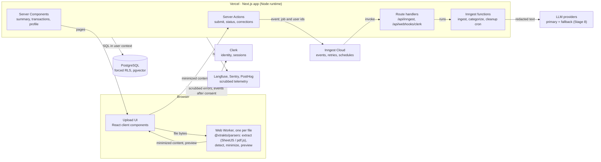
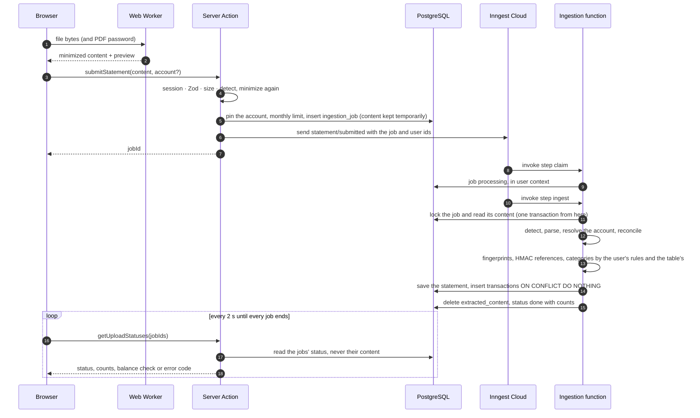
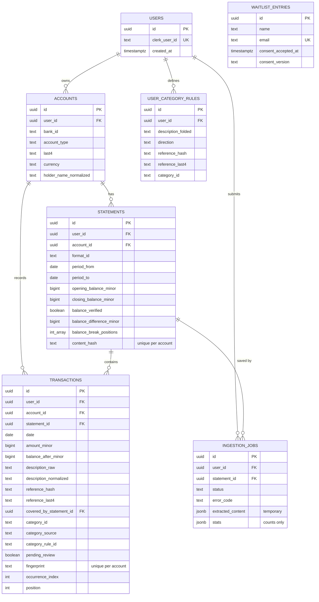
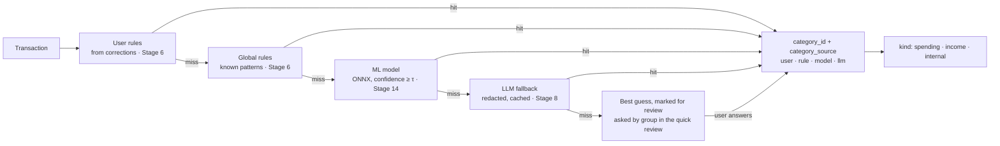
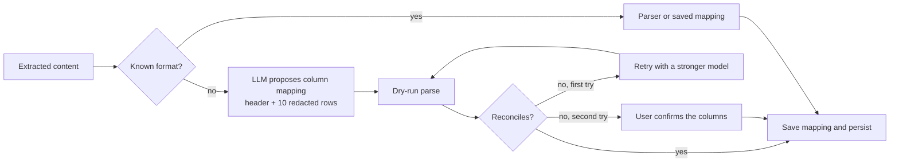
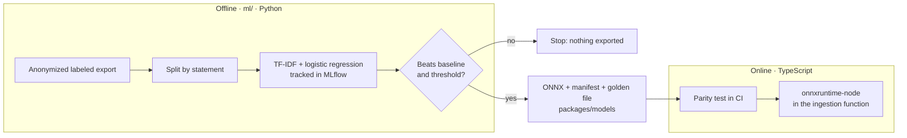
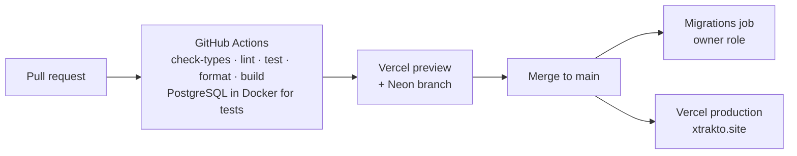

# Xtrakto — System Design

Architecture v1 (planned, October 2026). Stage numbers refer to `docs/ROADMAP.md`. Decisions are recorded as ADRs in `docs/adr/`.

Xtrakto reads Colombian bank statements and explains where the money went: real spending, money that only moved between the user's own accounts, income, recurring payments and fees.

---

## 1. Requirements

### Functional

- Upload one or several statements at once (spreadsheet now, PDF in Stage 9) from any supported bank. Overlapping date ranges are normal and are deduplicated.
- Parse every movement and verify the balances to the cent.
- Separate real spending, money that only moved (in either direction), and income.
- Categorize movements, ask the user by group about those that can't be classified alone, and let the user correct them.
- Show a summary: categories, the balance and real spending day by day, recurring payments, fees and insights.
- Explain cryptic lines in plain Spanish (Stage 8).
- Answer questions about the user's own data (Stage 13).
- Delete or export all of a user's data on request.
- Before the private beta, a public waitlist takes the name and email of whoever wants to try it, with their consent (16.0b).

### Constraints

- Financial data with PII: the original file and the PDF password never reach the server.
- Amounts as integer minor units; transaction dates as dates without time.
- Serverless hosting: no always-on worker; request bodies up to 4.5 MB on Vercel.
- Free tier with hard cost limits: LLM spend of USD 1 per user per month at most.
- Solo developer: managed services over self-hosted infrastructure.

### Quality attributes

| Attribute                 | Target                                                                                                             | How it is checked                                                                                |
| ------------------------- | ------------------------------------------------------------------------------------------------------------------ | ------------------------------------------------------------------------------------------------ |
| Correctness               | Balances reconcile to the cent. No movement counted twice across overlapping uploads.                              | `reconcile()` on every statement; fingerprints with a unique index; private tests on real files. |
| Privacy                   | Extracted content deleted when its job ends, and after 24 h at most.                                               | Job cleanup step and a daily cron; `docs/data-flow.md`.                                          |
| Isolation                 | A user can never read another user's rows, even through a buggy query.                                             | Forced Row-Level Security plus integration tests.                                                |
| Latency (initial targets) | Spreadsheet ingestion p95 < 10 s without LLM, < 30 s with it. Summary page p95 < 800 ms for a quarter (~500 rows). | Inngest run timings; Sentry performance traces.                                                  |
| Cost                      | Deterministic paths cost nothing. LLM spend capped per user and per platform.                                      | `llm_usage` checked before every call; Langfuse.                                                 |
| Degradation               | If every LLM provider fails, statements still load and summaries still compute; only uncategorized rows wait.      | Fallback chain covered by tests.                                                                 |

---

## 2. Architecture

One Next.js app on Vercel serves pages, receives uploads through server actions and runs the background functions. Slow work leaves the request path through Inngest. Everything that touches money lives in plain TypeScript packages testable without starting the app.

The original file and the PDF password never leave the browser. Each file is read in its own Web Worker, at most three at a time, so the page never freezes; the worker gets the file's bytes, never its name. All database access goes through `@xtrakto/db`, inside a transaction that sets `app.user_id` wherever there is a user. Clerk's middleware runs in `proxy.ts` and only redirects signed-out visitors early: every page, layout, server action and route handler checks the session itself, since server actions are called by id, not by path. The exception is the waitlist (`/waitlist` and `/waitlist/joined`) and its action, public by design: the action only adds a name and an email to a table the application can't read ([ADR 0021](adr/0021-insert-only-public-waitlist.md)). Clerk wraps only the layouts of the app, its welcome and sign-in, so the waitlist loads none of it. After sign-up Clerk sends the user to the welcome, three steps whose last one hands the files chosen there to the upload screen, in the browser's memory. Production is a private beta: Clerk's production instance lets only invited people create an account, while the waitlist stays open to anyone ([ADR 0027](adr/0027-private-beta-by-invitation.md)). Before it, production served only the waitlist, which `WAITLIST_ONLY=1` still brings back: the proxy sends every other path to it without Clerk, and the server needs only the database ([ADR 0022](adr/0022-waitlist-only-deployment.md)).

| Package or app     | Responsibility                                                                                                                       | Runs in                                      |
| ------------------ | ------------------------------------------------------------------------------------------------------------------------------------ | -------------------------------------------- |
| `apps/web`         | Routes, UI, server actions, webhooks, Inngest functions                                                                              | Browser and Vercel                           |
| `apps/video`       | The promo video in Remotion, with the design's tokens and invented data ([ADR 0020](adr/0020-promo-video-rendered-with-remotion.md)) | Locally only: rendered, never deployed       |
| `@xtrakto/core`    | Domain types, Zod schemas, money, dates, categories, PII redaction, summaries, insights                                              | Anywhere (pure)                              |
| `@xtrakto/parsers` | Spreadsheet and PDF extraction, bank parsers, reconciliation, format detection                                                       | Browser (preview) and server (authoritative) |
| `@xtrakto/db`      | Drizzle schema, migrations, RLS policies, persistence functions                                                                      | Server only                                  |
| `@xtrakto/models`  | Exported ONNX models with manifests and golden files (Stage 14)                                                                      | Server                                       |
| `@xtrakto/evals`   | Labeled datasets and evaluation runners for LLM features (Stage 8)                                                                   | CI and local                                 |
| `ml/`              | Training, evaluation and export of models in Python                                                                                  | Offline only                                 |

---

## 3. Ingestion flow

The upload request only validates and enqueues. An Inngest function claims the job, then parses, reconciles, prepares and saves the statement in one step and one database transaction, so a retry redoes it all or nothing ([ADR 0019](adr/0019-two-inngest-steps-with-ids-codes-and-counts.md)).

- **Events carry IDs only**, because Inngest stores and displays event payloads: the job's and its user's, since Row-Level Security shows the job only in its user's context. The content waits in the job row and is deleted as the last step, or by a daily cron if the job never finishes. An event that can't be sent deletes its job, content included, and the action fails.
- **Two steps ([ADR 0019](adr/0019-two-inngest-steps-with-ids-codes-and-counts.md)):** `claim` marks the job as processing; `ingest` does the rest in one transaction. Steps return ids, codes and counts only, and their errors are sanitized, since Inngest keeps step outputs, results and errors. Content no parser recognizes or the parser can't read, and an export the user has to place among several accounts, fail the job at once with their code; anything else is retried 3 times, and then the job fails with `INTERNAL_ERROR`. A user's jobs run one at a time, by the function's concurrency key and a per-user lock, so each statement's coverage and versions see the ones saved before it.
- **Monthly limit:** 10 statements per calendar month in Bogotá. Pending and processing jobs hold a slot; a finished one keeps it only if it added a movement, so a file already loaded costs nothing. The action counts and inserts under a per-user advisory lock, so two submissions can't both take the last slot.
- **Idempotency:** each transaction has a fingerprint (date, normalized description, amount, balance after, occurrence index) with a unique index per account, and each statement a hash of its content. Re-running a job or re-uploading a file inserts nothing new; an overlapping upload inserts only the movements the account doesn't have.
- **Account resolution:** the quarterly statement identifies the account by its last 4 digits: the user's account with them, else the only account without a number of its bank and type (an export created it), which takes the digits, else a new one; the holder's normalized name is kept on it. The movements export has no account number, so its job is pinned when submitted: to the user's only account, or to the one chosen on the upload screen, which can be the digits of an account a quarterly statement of the same upload creates. Unpinned, it goes to the only account the user has when it's processed, or to a new one without a number; with several, the job fails with `ACCOUNT_REQUIRED`.
- **Coverage ([ADR 0018](adr/0018-verified-quarterly-statement-covers-other-formats.md)):** the two formats give the same movements with different fingerprints, since only the quarterly statement prints balances. A verified quarterly statement covers its days, those after its opening balance's day through its closing balance's: a movements export's movements on them are saved hidden (`covered_by_statement_id`), in either upload order, until Phase 10.1 matches them. A movement counts when no statement hides it and its statement reconciles or prints no balances; every reader uses that predicate.
- **Versions of a period:** another version of a quarterly statement replaces one that doesn't reconcile; one that reconciles keeps later versions out. Movements exports have no versions.
- **Authoritative parse:** the browser parse is only a preview; the server parses again from the same content.
- **Categories ([ADR 0023](adr/0023-rules-give-a-best-guess-and-flag-what-to-review.md)):** after preparing the movements, `ingest` gives each one the category of the user's rule that holds for it, else of the first rule of the table that knows it, with that rule's id and whether the category is a best guess to review (§6, [ADR 0025](adr/0025-user-rules-come-first-and-keep-the-rules-guess.md)). A movement saved before keeps its category, since its insert does nothing; saving a user's rule gives its category to the user's movements already saved.
- **Payload size:** only the minimized rows or text items travel. The browser refuses a file whose content would pass 3.5 MB, and the action checks the same cap; it accepts bodies of up to 4 MB, under Vercel's 4.5 MB request limit.
- **Status:** the upload screen asks about its open jobs every 2 seconds, in one call, until they end; it stops after 3 failures in a row or 10 minutes without a change, until the person asks again. The jobs' ids live in the URL's fragment (`#jobs=…`), so a reload shows them again; a search param would make Next.js mount the page anew after each refresh, losing the files on screen. A job open for more than 2 minutes, by the database's clock, is shown as late. A finished job shows its result: the movements in the file, those the account already had and the new ones, and its statement's balance check (verified, doesn't reconcile, or none to verify); a failed one, what happened in plain words for its error code. A verified quarterly statement that opens with the verified closing balance of the account's statement ending the day it starts is chained ("Encadenado"), found when read, so the upload order doesn't matter. Beside the upload, the latest 30 files sent are listed newest first, each with its result, named by format and period.
- **Several files at once:** each file becomes its own job, so one unreadable file doesn't hold back the rest. The upload screen sends them one at a time, so the monthly limit stops the rest, and a send that gets no answer can be retried. Overlapping ranges deduplicate through the fingerprints, and the result says how many movements the user already had.

---

## 4. Privacy boundaries

| Party                | Receives                                                                                                                                                                                             | Never receives                                                                              | Kept for                                                                          |
| -------------------- | ---------------------------------------------------------------------------------------------------------------------------------------------------------------------------------------------------- | ------------------------------------------------------------------------------------------- | --------------------------------------------------------------------------------- |
| User's browser       | Original file, PDF password, extracted content                                                                                                                                                       | —                                                                                           | While the page is open                                                            |
| Next.js server       | Minimized extracted content: only what the parser reads ([ADR 0017](adr/0017-content-minimized-before-sending.md)); the waitlist's names and emails                                                  | Original file, PDF password, address, full account number                                   | Not kept; minimized again and written to the job row                              |
| PostgreSQL           | Temporary minimized content, with raw references until the job ends; parsed transactions; normalized holder name; HMACs of references and their last 4 digits                                        | Full account numbers, addresses, PDF password; raw references outside the temporary job row | Content: until the job ends (24 h max). Transactions: until the user deletes them |
| PostgreSQL, waitlist | The name, normalized email, consent version and consent time of each person who joins; the application may only add them ([ADR 0021](adr/0021-insert-only-public-waitlist.md))                       | Any link to an account                                                                      | Until the launch notice is sent, or until the person asks (hola@xtrakto.site)     |
| Inngest Cloud        | Event names and IDs; step outputs and run results with statuses, error codes and counts; sanitized errors                                                                                            | Any financial content                                                                       | Inngest run history                                                               |
| LLM providers        | Redacted descriptions; for unknown formats, the header and up to 10 redacted sample rows                                                                                                             | Names, phone numbers, ID and account numbers                                                | Provider's API data policy                                                        |
| Clerk                | Email, name, sign-in data                                                                                                                                                                            | Financial data                                                                              | Until the account is deleted                                                      |
| Sentry               | Errors and a tenth of the traces, through an allowlist ([ADR 0028](adr/0028-errors-reach-sentry-through-an-allowlist.md))                                                                            | Request bodies, action arguments, cookies, queries, IPs, descriptions, amounts              | Sentry retention                                                                  |
| PostHog              | Only after the person's consent: the app's events with format ids, count buckets and error codes, a random id and the browser ([ADR 0029](adr/0029-analytics-after-consent-through-an-allowlist.md)) | Descriptions, amounts, names, URLs, IPs, the city                                           | PostHog retention                                                                 |
| Langfuse             | Model, tokens, cost, latency                                                                                                                                                                         | Prompt and response content (masked)                                                        | Langfuse retention                                                                |

**Why HMAC and not a plain hash:** Colombian mobile numbers have 10 digits and start with 3, so a plain SHA-256 can be reversed by trying every number. References are hashed with HMAC-SHA-256 and a secret key, which still allows grouping transfers to the same person. Their last 4 digits are kept too, so the user can recognize their own Nequi ("ref ••• 1270"); 4 digits can't rebuild the number.

**Long numbers in descriptions:** a description can carry an account or phone number (`INTERES INV VIRT 27608017525`). Parsers hide all but the last four digits of every run of six or more, keeping the text's length (`INTERES INV VIRT *******7525`), so full numbers never reach the database ([ADR 0012](adr/0012-long-numbers-masked-when-parsed.md)). The browser already masks them when it minimizes the content, before sending it ([ADR 0017](adr/0017-content-minimized-before-sending.md)).

**Errors:** a database error's message lists its query's parameters, which can hold a statement's content, and Next.js logs whatever an action throws. So the server throws errors that name only what failed (the error's class, a SQLSTATE or system code, a constraint) before any log sees them. In development, Next.js also logs every action with its arguments (a statement's content, a waitlist email): `next.config.ts` turns that off. Errors from the browser and the server, and a tenth of the requests' traces, reach Sentry through an allowlist: Sentry 11 collects everything by default, so `dataCollection` turns each category off, and the SDK's hooks keep an error's class, masked message and stack, the page's path and the runtime, never a request's body, cookies, query or the user ([ADR 0028](adr/0028-errors-reach-sentry-through-an-allowlist.md)).

**Analytics:** the app asks once per browser whether it may measure how it's used, and keeps the answer there, versioned; the profile (`/profile`) changes it. Only with a yes does the browser download PostHog and send the app's own events: nothing captured automatically, nobody identified, and an allowlist keeps each event's properties and what PostHog needs to receive it, never a URL or the person's city. Withdrawing deletes the id PostHog kept ([ADR 0029](adr/0029-analytics-after-consent-through-an-allowlist.md)).

---

## 5. Data model

Amounts are `bigint` in minor units. Transaction dates are `date`; real instants are `timestamptz`. Every table has forced RLS: the five with a user's data on `user_id`, `users` so that a user can delete only their own row, which takes all their data with it through the cascades ([ADR 0016](adr/0016-users-delete-only-their-own-row.md)), and `waitlist_entries`, which the application may only add to ([ADR 0021](adr/0021-insert-only-public-waitlist.md)).

Foreign keys skip Row-Level Security, so they also carry `user_id`: a statement references its account by `(account_id, user_id)`, and a movement references its statement by `(statement_id, account_id, user_id)`. A row can't land on another user's account or on a statement of another account, and the statement that hides a movement (`covered_by_statement_id`) is of its account too, with no action on delete, checked when the transaction ends: a statement that hides movements can't be deleted without them, and a user's deletion removes both whatever order its cascades take. A statement is identified by its `content_hash`: the same file saved twice matches, while a corrected statement for the same period doesn't; a partial unique index keeps one version of each period with balances, and another keeps one account without a number per bank and type. A statement that doesn't reconcile keeps its closing difference and the positions where its chain of balances breaks. A movement keeps the table's rule that matched it (`category_rule_id`, a stable id), also when the user decides, and whether its category is a best guess to review (`pending_review`); CHECK constraints allow a rule's id only with a category a rule or the user gave, and a review only with a rule's guess ([ADR 0023](adr/0023-rules-give-a-best-guess-and-flag-what-to-review.md), [ADR 0025](adr/0025-user-rules-come-first-and-keep-the-rules-guess.md)). A user's rule is a bank text, folded, with the direction of its money, or a reference's HMAC with its last 4 digits, never both; a unique index keeps one per text and direction and one per reference, and the bank's `0` never makes one. Its kind is its category's, never stored apart ([ADR 0024](adr/0024-kind-comes-from-the-category.md)). `position` keeps the bank's order within a day; `occurrence_index` tells apart identical movements in one statement and is part of the fingerprint. The application connects as `xtrakto_app`, which owns no table and can't bypass RLS; `withUserContext` sets `app.user_id` for one transaction ([ADR 0014](adr/0014-forced-rls-with-transaction-local-user.md)). The one exception is the daily cleanup of ingestion jobs, which has no user: it calls `expire_stale_ingestion_jobs()`, a `SECURITY DEFINER` function without parameters, with a fixed `search_path`, that only the application may run. CHECK constraints keep amounts within JavaScript's safe integers and require a finished ingestion job to hold no content: a failed one says why, and a done one names the statement it saved, or the one that already held its movements.

Later stages add `llm_usage` (8), `format_mappings` without user data (11), `usury_rates` (12) and document chunks with embeddings in pgvector (15).

---

## 6. Categorization

Each transaction falls through the chain until one stage is confident. The LLM only sees what nothing cheaper could classify. No stage computes amounts.

- The category's `kind` drives the headline numbers. Credit card payments, investments and own-account transfers are `internal`: they leave the account but are not spending. Internal goes both ways: money that comes back from the user's own Nequi or name is not income either.
- The global rules are an ordered table in `@xtrakto/core` (`CATEGORIZATION_RULES`, from ROADMAP Appendix B): each one matches the description's words, folded (no case, accents or extra spaces) and never inside a word, and says which way the money goes, so `ABONO INTERESES AHORROS` is interest only when money comes in. The first rule that matches wins, and each carries the reason the movement's detail shows.
- Own-account transfers are detected by the holder's normalized name, which a quarterly statement prints and the account keeps for its exports, and by the Nequi numbers the user marked as theirs, in the quick review or a movement's detail (6.3d, 6.3h); any other text becomes theirs by the user's rule for it. `TRANSF A`, `TRANSF DE` and `PAGO LLAVE` name the holder when their words are the holder's, in order, starting with the first name: whole words from the first name to a surname count as moved; a name the bank cut, inside a word or before any surname as it usually does, counts as moved and waits for review. A sibling with the same surnames has another first name.
- A purchase or a payment no merchant rule knows is "Otros", real spending, until a later stage or the user names it; only money in that no rule knows stays without a category, and without a kind.
- Some movements can't be classified alone: Bre-B _llave_ payments, PSE payments to banks, fintechs, lenders and investment platforms, transfers to the truncated holder name, money in from Nequi, Nequi sends that name their number (only movements exports carry it), cash deposits at a _corresponsal_, the bank's `0`. They keep a best guess marked for review, which follows design v8: money in from the user's Nequi or name, a deposit at a _corresponsal_ and a key payment to a savings platform count as moved until the user answers. The quick review (`/review`) asks about an account's quarter by group, the guess first; each answer saves a user rule per text, except for the bank's `0`, which gets its category movement by movement, and "No sé" keeps the guess and takes the movements out of the review. The Nequi sends are asked number by number: each number's rule makes it the user's (moved) or someone else's ([ADR 0026](adr/0026-nequi-numbers-and-reference-rules-by-direction.md)). An answered group stays on the review, closed, saying what its movements count as now: they keep the rule that guessed them, so the review finds them again. "Cambiar" answers it again, and the summary shows a banner while groups wait. Beside the groups, "Lo que está en juego" weighs each open one: what another answer would make the quarter's real spending or income, from the same totals by kind as Movimientos.
- The channel shown on each movement (PSE, Llave Bre-B, QR, Nequi, cajero…) comes from the description's prefix; it is not a category.
- The user's rules come first ([ADR 0025](adr/0025-user-rules-come-first-and-keep-the-rules-guess.md)): a bank text, folded, for money going one way, or a reference, which names one person or account and holds the ways its category allows: money that only moves both ways, a payment to someone going out, an income coming in ([ADR 0026](adr/0026-nequi-numbers-and-reference-rules-by-direction.md)). The user's category is never a guess, and the movement keeps the table's rule that matched, so the quick review still knows what it guessed. Saving a rule gives its category to the user's movements already saved, in every statement; a text's rule leaves those a reference's rule holds, which comes first.
- A movement's detail in Movimientos corrects its kind and category, those its money's direction allows: for that movement, the user's category, or for every movement with its text, a rule (6.3g). There the user also makes a Nequi number theirs, and undoes the rule for its number or its text: the movements it held take what the user's other rules say, else the table's rule each one kept (6.3h). User corrections are the labeled data for the ML model (Stage 14).

---

## 7. Agents

### Ingestion agent for unknown formats (Stage 11)

Known formats never touch the LLM. For a new bank the agent proposes a column mapping, proves it by reconciling, and saves it, so the next file from that bank is parsed deterministically.

Reconciliation is the agent's ground truth. Saved mappings hold column roles and formats, never user data.

### Chat agent (Stage 13)

- Typed tools only: `getTransactions`, `getSpendingByCategory`, `getRecurring`, `getSummary`, `findTransactions`. No model-generated SQL.
- The user id comes from the session inside each tool, never from the model's arguments.
- Transaction descriptions are untrusted data in the prompt; answers cite the transactions used.
- Questions the tools can't answer can run in a Pyodide sandbox in the browser.

---

## 8. ML lifecycle

Python never serves users. Only a model that beats the rule-based baseline is exported; production runs the ONNX file from Node, and a parity test in CI guarantees both languages predict the same.

Splitting by statement, not by row, keeps near-identical movements of one statement out of both train and test.

---

## 9. Infrastructure

|                 | Local                                    | Preview (per PR)           | Production                                                                       |
| --------------- | ---------------------------------------- | -------------------------- | -------------------------------------------------------------------------------- |
| App             | `pnpm dev`                               | Vercel preview deployment  | Vercel production · xtrakto.site; private beta by invitation (ADR 0027)          |
| Database        | Docker Compose: PostgreSQL 18 + pgvector | Neon branch                | Neon (AWS us-east-1), `main` branch                                              |
| Auth            | Clerk development instance               | Clerk development instance | Clerk production instance on xtrakto.site; sign-up by invitation only            |
| Background jobs | Inngest Dev Server in Docker Compose     | Inngest branch environment | Inngest production                                                               |
| Migrations      | `pnpm db:migrate`                        | Applied to the branch      | CI job on `main` with the owner role                                             |
| Secrets         | `.env.local`                             | Vercel preview variables   | Vercel production variables; migration URL as a GitHub secret                    |
| DNS and email   | —                                        | —                          | DNS at Hostinger; Resend on `mail.xtrakto.site` with SPF, DKIM, DMARC (Stage 10) |

Vercel deploys `main` while the migrations job runs, so migrations must stay backward compatible: expand the schema, deploy, then remove what old code used.

---

## 10. Failure modes

| Failure                          | Detected by                       | Behavior                                                                                                                                                             |
| -------------------------------- | --------------------------------- | -------------------------------------------------------------------------------------------------------------------------------------------------------------------- |
| Unknown format                   | No parser matches                 | MVP: clear message. Stage 11: the ingestion agent proposes a mapping.                                                                                                |
| Balances don't add up            | `reconcile()` issues              | Saved with `balance_verified = false`, so the user can see the affected rows ("Ver dónde no cuadra"); its numbers stay out of every summary until it reconciles.     |
| Same days in two formats         | A verified quarterly's days       | The movements export's movements on them are saved hidden, in either order (ADR 0018); nothing counts twice.                                                         |
| Another version of a period      | One version per period, by index  | Replaces a version that doesn't reconcile; stays out when one does.                                                                                                  |
| Duplicate upload                 | Fingerprint conflict              | Nothing new inserted; the user is told it was already loaded.                                                                                                        |
| Step fails mid-job               | Inngest error                     | The step's transaction rolls back and Inngest retries it, up to 3 times; writes are idempotent. Then the job fails with `INTERNAL_ERROR` and its content is deleted. |
| Content unreadable on the server | Server parse, account resolution  | The job fails at once with `UNKNOWN_FORMAT`, `PARSE_FAILED` or `ACCOUNT_REQUIRED` and its content is deleted; it holds no slot of the monthly limit.                 |
| LLM timeout or invalid output    | Timeout or Zod validation         | One retry on the fallback model; then rows stay uncategorized.                                                                                                       |
| Cost limit reached               | `llm_usage` check before the call | LLM step skipped; the user sees when the limit renews.                                                                                                               |
| Job never finishes               | Daily cleanup at 03:00 in Bogotá  | After 24 hours pending or processing, the job fails with `CONTENT_EXPIRED` and its content is deleted; it frees its slot.                                            |
| Payload too large                | Size checks in browser and action | Rejected with a message; the server enforces the same bounds.                                                                                                        |
| Event not sent                   | `inngest.send` throws             | The job is deleted with its content and the action fails, so nothing waits for an event that never came.                                                             |
| Account deleted in Clerk         | `user.deleted` webhook            | All the user's rows are deleted; repeated deliveries delete nothing more.                                                                                            |

---

## 11. Scaling path

| Load                  | What changes                                                                                                                                                                                                                                                                                                                                                                                                                           |
| --------------------- | -------------------------------------------------------------------------------------------------------------------------------------------------------------------------------------------------------------------------------------------------------------------------------------------------------------------------------------------------------------------------------------------------------------------------------------- |
| Private beta          | One database. One ingestion job per user at a time. Summaries computed in TypeScript from a period's transactions, its fixed payments from the year that ends with it. The movements list reads a period's movements and shows 30 lines at a time, a month's daily interest in one; SQL adds up a period's kind totals by category, which the quick review weighs its groups against too, and TypeScript maps the categories to kinds. |
| Thousands of users    | Aggregates move to SQL with monthly rollups per account. Connection pooling tuned.                                                                                                                                                                                                                                                                                                                                                     |
| Hundreds of thousands | Partition `transactions` by user or month. Read replica for dashboards. Model inference in a dedicated service if needed.                                                                                                                                                                                                                                                                                                              |

---

## 12. Key decisions

| Decision                                                                           | Why                                                                                                         | Alternative considered                                          | ADR                                                                                                   |
| ---------------------------------------------------------------------------------- | ----------------------------------------------------------------------------------------------------------- | --------------------------------------------------------------- | ----------------------------------------------------------------------------------------------------- |
| TypeScript backend in Next.js                                                      | One language and one deployment; types shared from UI to database.                                          | Python API with FastAPI                                         | [0002](adr/0002-typescript-backend-python-for-ml.md)                                                  |
| PostgreSQL with Drizzle                                                            | Tabular, analytical data; RLS; pgvector.                                                                    | Convex                                                          | [0003](adr/0003-postgresql-with-drizzle.md)                                                           |
| Neon, through `pg` and a pool                                                      | Serverless; a branch per preview; only the database is needed.                                              | Supabase; Neon's HTTP driver (no interactive transactions)      | [0013](adr/0013-neon-for-postgresql.md)                                                               |
| Inngest for background work                                                        | Long, retryable, step-based jobs on serverless hosting.                                                     | pg-boss (needs an always-on worker)                             | [0005](adr/0005-inngest-for-background-work.md)                                                       |
| Files read in the browser                                                          | Original file and PDF password never leave the device; no file storage.                                     | Upload to object storage and parse on the server                | [0008](adr/0008-files-read-in-the-browser.md)                                                         |
| Content minimized before sending                                                   | Only what the parser reads leaves the browser; references are the only identifiers, until the job ends.     | Send the whole content and document it                          | [0017](adr/0017-content-minimized-before-sending.md)                                                  |
| A verified quarterly covers other formats                                          | The same movements in two formats count once, in either order, until 10.1 matches them.                     | Match movements now; delete the export's movements              | [0018](adr/0018-verified-quarterly-statement-covers-other-formats.md)                                 |
| SheetJS for spreadsheets                                                           | Reads XLSX and CSV in the browser and Node; date cells stay serials.                                        | ExcelJS (turns dates into `Date` objects)                       | [0011](adr/0011-sheetjs-for-spreadsheet-extraction.md)                                                |
| Two Inngest steps with ids, codes and counts                                       | Inngest keeps step outputs and errors; one transaction saves a statement all or nothing.                    | One step per stage                                              | [0019](adr/0019-two-inngest-steps-with-ids-codes-and-counts.md)                                       |
| Events carry IDs only                                                              | Event payloads are stored and shown by the queue provider.                                                  | Content in the event                                            | [0005](adr/0005-inngest-for-background-work.md)                                                       |
| Insert-only public waitlist                                                        | The list can't leak through the app, and every email gets the same answer.                                  | A form service; a conflict target with a read policy            | [0021](adr/0021-insert-only-public-waitlist.md)                                                       |
| A waitlist-only deployment                                                         | The waitlist goes public before the app, without Clerk or Inngest in production.                            | The whole app with production services; a static site           | [0022](adr/0022-waitlist-only-deployment.md)                                                          |
| A private beta by invitation                                                       | Real statements only from invited people until the privacy page, monitoring and legal review.               | Open sign-up; Clerk's waitlist mode                             | [0027](adr/0027-private-beta-by-invitation.md)                                                        |
| Errors reach Sentry through an allowlist                                           | Sentry 11 collects everything by default; what a later version adds stays out until it has a reason.        | Sentry's server-side scrubbing; a blocklist                     | [0028](adr/0028-errors-reach-sentry-through-an-allowlist.md)                                          |
| Analytics only after consent, from the browser, through an allowlist               | Nothing loads or goes without a yes; withdrawing is as easy and forgets the browser.                        | Events from the server; cookieless mode; consent in the account | [0029](adr/0029-analytics-after-consent-through-an-allowlist.md)                                      |
| Promo video in Remotion                                                            | The screens it shows don't exist yet; drawn from the design and versioned with it.                          | Screen recording; AI-generated video                            | [0020](adr/0020-promo-video-rendered-with-remotion.md)                                                |
| Deterministic first, LLM as fallback                                               | Exact, free and testable for known formats.                                                                 | LLM extraction for everything                                   | [0009](adr/0009-deterministic-parsing-first.md)                                                       |
| Integer minor units and date-only dates                                            | No floating-point drift; no time-zone shifts.                                                               | Decimals and timestamps                                         | [0006](adr/0006-money-as-integer-minor-units.md), [0007](adr/0007-transaction-dates-as-local-date.md) |
| Forced RLS with a transaction-local setting                                        | A second barrier when a query forgets its filter.                                                           | Application-level filtering only                                | [0014](adr/0014-forced-rls-with-transaction-local-user.md)                                            |
| Rules give a best guess and flag what to review                                    | Free, exact and testable; the quick review groups movements by the rule that guessed.                       | A confidence score; an Inngest step of its own                  | [0023](adr/0023-rules-give-a-best-guess-and-flag-what-to-review.md)                                   |
| A movement's kind comes from its category                                          | One source for the kind, whoever sets the category; no migration when a category changes kind.              | A stored kind; a generated column                               | [0024](adr/0024-kind-comes-from-the-category.md)                                                      |
| The user's rules come first and keep the rule's guess                              | An answer holds for every statement, saved or to come; the review still knows what the rule guessed.        | Updating only the answered movements; dropping the rule's id    | [0025](adr/0025-user-rules-come-first-and-keep-the-rules-guess.md)                                    |
| Nequi numbers wait for review; a reference rule holds the ways its category allows | The review, its banner and Movimientos count the same; a number someone else's is remembered for money out. | Sure sends, as v8-03 draws them; a direction column             | [0026](adr/0026-nequi-numbers-and-reference-rules-by-direction.md)                                    |
