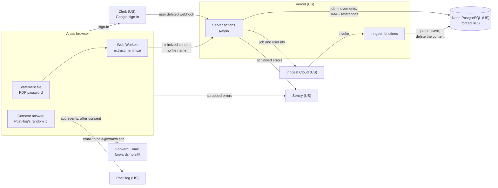

# Data flow

Where a person's data goes in Xtrakto, what each place keeps and for how long. The privacy page (`/privacy`, Phase 7.5) says the same in plain Spanish; a change here changes it too, and its date. The system design's privacy boundaries (`docs/ARCHITECTURE.md` §4) are the rules this document follows.

Example: Ana uploads her quarterly statement. Her browser reads the file and sends only the rows the parser reads, the account's last 4 digits and long numbers masked; the server saves her movements under her user, and the job's copy of what was sent is deleted when the job ends. Inngest only ever sees the job's id and hers. If she said yes to the usage notice, PostHog gets `statement_uploaded` with the format and a range of movements, and nothing else.

## What stays in the browser

| Data                                    | Why                                                                   | Kept for                                          |
| --------------------------------------- | --------------------------------------------------------------------- | ------------------------------------------------- |
| The statement file and its name         | Read by a Web Worker, which gets the bytes, never the name (ADR 0008) | While the upload page is open                     |
| A PDF's password (Stage 9)              | Opens the file in the worker                                          | While the upload page is open                     |
| The extracted content, unminimized      | Minimized before sending: only what the parser reads (ADR 0017)       | While the upload page is open                     |
| Clerk's session cookies                 | Keep the person signed in                                             | Clerk's session lifetime                          |
| The analytics consent, with its version | Asks once per browser (ADR 0029)                                      | Until the person changes it or clears the browser |
| PostHog's random id (`localStorage`)    | Counts a browser once, only after a yes; withdrawing deletes it       | Until consent is withdrawn                        |

## What reaches the server

The server receives the minimized content: the rows the parser reads, the account's last 4 digits, long numbers in descriptions masked (ADR 0012), and references raw only so that it can hash them. It minimizes the content again, writes it to the job's row, and never keeps it anywhere else; Next.js's own logging of action arguments is off (`next.config.ts`), and errors are sanitized before any log sees them. Vercel keeps short-lived request logs (path, status, the client's IP) for its own operation.

## What the database keeps

| Data                                                                                       | Kept for                                                                |
| ------------------------------------------------------------------------------------------ | ----------------------------------------------------------------------- |
| A job's minimized content, raw references included                                         | Until the job ends; 24 hours at most (daily cleanup at 03:00 in Bogotá) |
| Statements: period, balances, balance check, content hash                                  | Until the person deletes their account                                  |
| Movements: date, the bank's text, amount, balance, category; references as HMAC and last 4 | Until the person deletes their account                                  |
| Accounts: bank, type, last 4 digits, the holder's normalized name                          | Until the person deletes their account                                  |
| The person's category rules and review answers                                             | Until they're undone, or the account is deleted                         |
| `users`: the Clerk id                                                                      | Until the account is deleted                                            |
| The waitlist: name, normalized email, consent version and time                             | Until the launch notice, or until the person asks (ADR 0021)            |

Every table forces Row-Level Security: a person's rows are readable only in their own context (ADR 0014). Deleting the account (`/profile`, or Clerk's `user.deleted` webhook) deletes the `users` row, and the cascades take everything else with it (ADR 0016).

## What each third party receives

| Party                     | Receives                                                                                                             | Never receives                                                    | Kept for                       |
| ------------------------- | -------------------------------------------------------------------------------------------------------------------- | ----------------------------------------------------------------- | ------------------------------ |
| Vercel                    | The app's requests and responses; short-lived request logs                                                           | The statement file, the PDF password                              | Vercel's log retention         |
| Neon                      | The database above, encrypted in transit (`sslmode=verify-full`)                                                     | Full account numbers, addresses, the PDF password                 | As the database keeps it       |
| Clerk, and Google sign-in | Name, email, sign-in data (device, IP, sessions)                                                                     | Financial data                                                    | Until the account is deleted   |
| Inngest Cloud             | Event names with the job's and the user's ids; step outputs and errors with ids, codes and counts (ADR 0019)         | Any financial content                                             | Inngest's run history          |
| Sentry                    | Errors and a tenth of the traces, through an allowlist (ADR 0028)                                                    | Request bodies, action arguments, cookies, queries, IPs, the city | Sentry's retention             |
| PostHog                   | Only after consent: the app's events with format ids, ranges and error codes, a random id and the browser (ADR 0029) | Amounts, descriptions, names, URLs, IPs, the city                 | PostHog's retention            |
| Hostinger, Forward Email  | DNS (Hostinger); the emails people send to hola@xtrakto.site, which Forward Email forwards to the owner's mailbox    | Anything from the app                                             | Forwarding only                |
| LLM providers (Stage 8)   | Not used yet. Later: redacted descriptions only (system design §4)                                                   | Names, phone, ID and account numbers                              | The provider's API data policy |

Every party above keeps its data in the United States, which the privacy page tells as an international transfer.

## A person's rights

The privacy page names the controller (Carlos Tello, Bogotá) and the contact, hola@xtrakto.site, for the rights of Ley 1581 de 2012: to know, update and correct the data, ask for proof of the authorization, withdraw it or ask for deletion, and complain to the SIC. Queries are answered within 10 business days and claims within 15. Deleting the account in `/settings` needs no email, and neither does knowing the data: "Descargar mis datos (CSV)" there hands the browser every movement saved, also those that count nowhere, with only a reference's last 4 digits (7.6). A legal review of the page is pending before the public launch (16.4).
